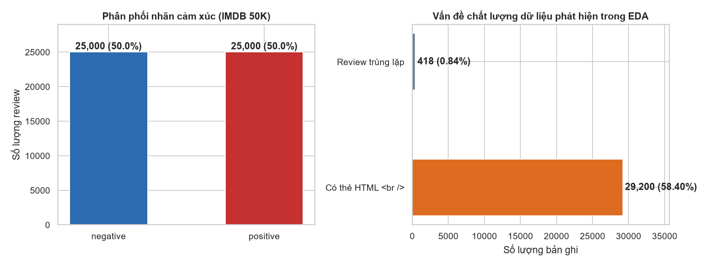
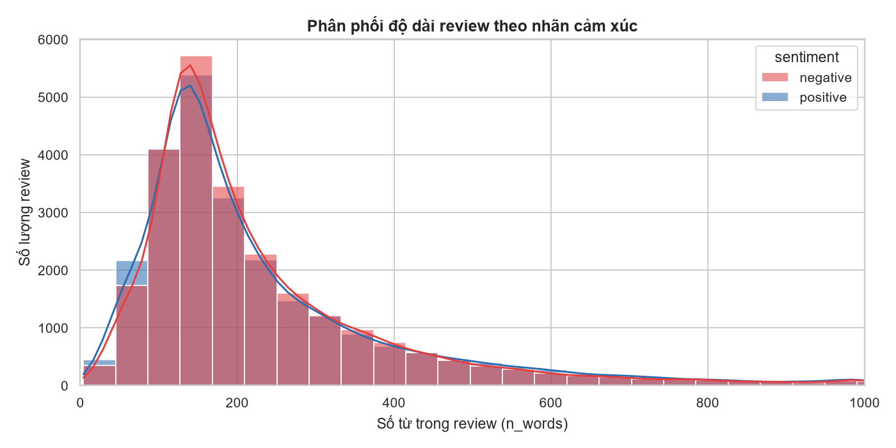
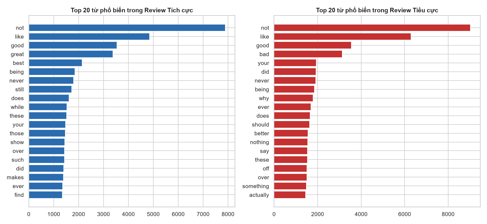
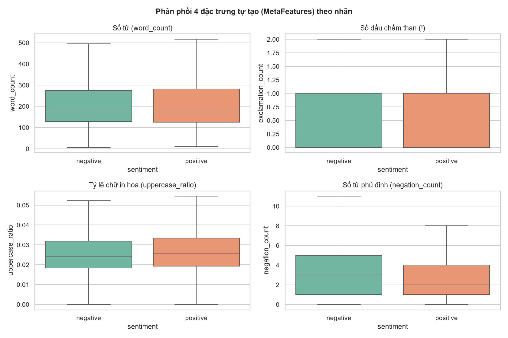
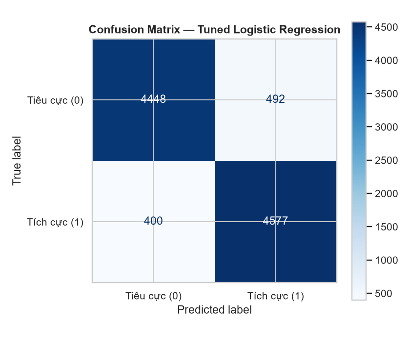
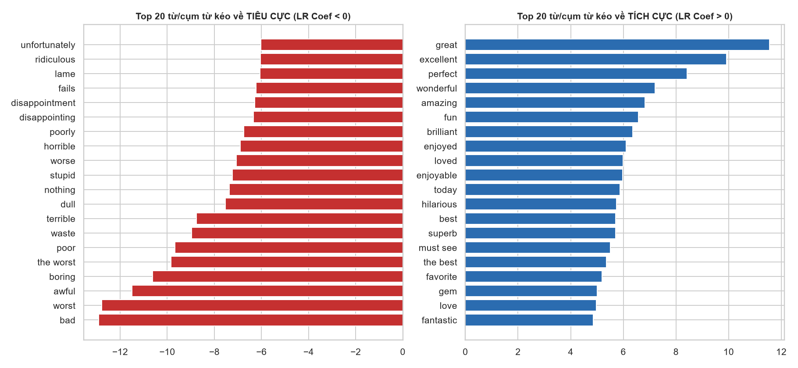
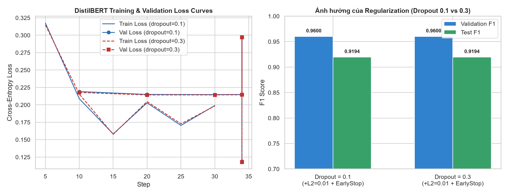

# Technical Report: End-to-End Applied Machine Learning System for IMDB Movie Review Sentiment Analysis

**Course:** MDS301 — Machine Learning in Data Sciences  
**Lead Author:** Võ Phan Bảo Chương (SE196645)  
**Date:** November 2026  

---

## 1. Executive Summary

This report presents the design, implementation, evaluation, and deployment of an end-to-end Natural Language Processing (NLP) system for automated binary sentiment analysis on the **IMDB 50K Movie Reviews** dataset. Our pipeline addresses critical real-world text quality challenges—including `29,200` HTML-polluted reviews (` `), `418` duplicate entries, negation polarity reversal (`"not bad"`), and mixed-sentiment reviews.

We benchmarked four distinct model architectures across classical machine learning and deep learning: **Logistic Regression**, **Linear Support Vector Machine (`LinearSVC`)**, **Random Forest**, and fine-tuned **DistilBERT (`distilbert-base-uncased`)**. Using an identical stratified 80/20 split (`39,665` train / `9,917` test, `random_state=42`) and 5-fold cross-validation (`GridSearchCV`), our tuned **TF-IDF (1–2 gram) + MetaFeatures + Logistic Regression** pipeline achieved a **Test F1-Score of `0.9112`** and **Test Accuracy of `91.01%`** with an average CPU inference latency of **`1.023 ms/review`** (~80× faster than DistilBERT on CPU). The final model is serialized with `joblib`, tracked via **MLflow**, exposed through a validated **FastAPI** service with word-level explainability (`explain()`), containerized with **Docker**, and monitored for covariate shift via two-sample Kolmogorov–Smirnov drift tests.

---

## 2. Problem Formulation & Success Criteria

### 2.1 Real-World Motivation
Streaming services, film distributors, and review aggregators process thousands of audience reviews daily. Automated sentiment classification enables real-time audience reception tracking, aspect flagging, and recommendation filtering without manual human annotation.

### 2.2 ML Task Justification
- **Supervised Binary Classification:** Each review is associated with a discrete polarity (`positive = 1` for rating $\ge 7/10$, `negative = 0` for rating $\le 4/10$).
- **Primary Evaluation Metrics:**
  - **F1-Score (Primary):** Harmonic mean of Precision and Recall, ensuring balanced evaluation across both classes.
  - **Accuracy, Precision & Recall (Secondary):** Measures overall correctness and class-specific error rates.
  - **Inference Latency (`ms/review`):** Critical operational metric for real-time REST API deployment on CPU hardware.

---

## 3. Exploratory Data Analysis (EDA) & Data Quality Audit

| Audit Dimension | Finding on IMDB 50K Dataset | Engineering Action Taken |
| :--- | :--- | :--- |
| **Sample Size & Balance** | `50,000` total reviews: `25,000` positive (`50.0%`) and `25,000` negative (`50.0%`). | Stratified train/test splitting (`stratify=y`) preserves exact 50/50 balance. |
| **Duplicate Records** | `418` exact duplicate reviews (`0.84%`). | Removed **before** splitting (`df.drop_duplicates("review")`), leaving `49,582` unique reviews. Prevents train-to-test data leakage. |
| **HTML Noise (` `)** | `29,200` reviews (`58.40%`) contain ` ` tags. | Stripped via regex `re.sub(r"<.*?>", " ", s)` inside `clean_text()`. |
| **Review Length Skewness** | Mean = `231.2` words, Median = `173.0` words, Max = `2,470` words (strongly right-skewed). | Applied `sublinear_tf=True` ($1 + \log(\text{tf})$) in `TfidfVectorizer` and `StandardScaler` on `MetaFeatures`. |
| **Negation Words** | Standard stopword lists contain `"not"`, `"no"`, `"never"`. Negative reviews have **28.4% more negations** (`3.74` vs `2.92` per review). | **Did NOT remove stopwords**; preserved negation words and used `ngram_range=(1, 2)` with `max_df=0.9`. |

---

## 4. Preprocessing & Custom Feature Engineering (`src/features.py`, `src/pipeline.py`)

Our preprocessing pipeline is implemented as a unified Scikit-learn `Pipeline` wrapping a `ColumnTransformer` with two parallel branches:

1. **Branch 1 — `TfidfVectorizer` (`ngram_range=(1, 2)`, `min_df=5`, `max_df=0.9`, `sublinear_tf=True`):**
   - Applies `clean_text()` to strip HTML tags and normalize whitespace.
   - Captures unigrams and bigrams (`"not good"`, `"not bad"`, `"waste of"`).
   - Fitted strictly inside each cross-validation fold to prevent vocabulary/IDF leakage.
2. **Branch 2 — Custom `MetaFeatures` + `SimpleImputer(strategy="median")` + `StandardScaler`:**
   - Extracts four domain-motivated statistical features from raw text *prior* to lowercasing:
     - `word_count`: Total number of whitespace-delimited tokens.
     - `exclamation_count`: Number of `!` characters (`1.09` in negative vs `0.88` in positive reviews).
     - `uppercase_ratio`: Ratio of uppercase characters to total characters (captures emphatic shouting).
     - `negation_count`: Number of negation tokens (`{"not", "no", "never", "nor", "cannot", "n't"}`).

---

## 5. Model Development, Tuning & Bias–Variance Analysis

### 5.1 Master Comparison Table (`80/20` Split, `random_state=42`)

| Model | Train F1 | Test F1 | CV F1 (5-Fold) | Test Acc | Test Precision | Test Recall | Train Time (s) | Latency (ms/review) | Tuned? | Diagnosis |
| :--- | :---: | :---: | :---: | :---: | :---: | :---: | :---: | :---: | :---: | :--- |
| **Logistic Regression (Baseline)** | 0.9539 | 0.9019 | 0.9038 | 0.9004 | 0.8912 | 0.9130 | 59.1 | 1.049 | No | Well-fitted (`5.2%` gap) |
| **Linear SVM (`LinearSVC`)** | 0.9996 | 0.9159 | 0.9152 | 0.9149 | 0.9090 | 0.9228 | 125.9 | 1.151 | No | High capacity, slight overfit |
| **Random Forest (`200 trees`)** | 1.0000 | 0.8590 | 0.8442 | 0.8580 | 0.8564 | 0.8616 | 132.9 | 1.030 | No | **Overfitting (`14.1%` gap)** |
| **DistilBERT (`Fine-tuned, dropout=0.1`)** | 0.9600 | **0.9194** | 0.9268 (Val) | **0.9167** | 0.9167 | 0.9194 | 214.3 | 83.340 | Yes | Highest accuracy (`models/distilbert/`), ~81× slower on CPU |
| **Logistic Regression (Tuned ★)** | **0.9881** | **0.9112** | **0.9130** | **0.9101** | **0.9029** | **0.9196** | **885.4** | **1.023** | **Yes** | **Deployed Production Model** |

### 5.2 Bias–Variance Analysis & Why Random Forest Overfits
- **Random Forest Overfitting Diagnosis:** On high-dimensional sparse TF-IDF matrices (`max_features=20,000`), Random Forest achieves a perfect `Train F1 = 1.0000` but drops to `Test F1 = 0.8590` (`CV F1 = 0.8442`). Because each decision tree split only inspects a small subset of word features ($\sqrt{p} \approx 141$ tokens), deep trees memorize specific rare word combinations in the training set rather than learning a global linear hyperplane across all words.
- **5-Fold `GridSearchCV` on Logistic Regression:** Sweeping `model__C` $\in \{0.5, 1, 2, 4\}$ and `features__tfidf__min_df` $\in \{2, 5\}$ across 5 folds (40 fits) selected **`C = 4, min_df = 5`**, improving 5-fold CV F1 from `0.9038` to `0.9130` and Test F1 from `0.9019` to **`0.9112`**.

---

## 6. Deep Learning Component: Fine-Tuned `DistilBERT` & Regularization Analysis

### 6.1 Architecture & Training Setup
We fine-tuned `distilbert-base-uncased` (6 Transformer layers, 12 attention heads, 768 hidden units, ~66M parameters) with a sequence classification head (`768 -> 768 -> 2`).

### 6.2 Effect of Regularization (`Dropout = 0.1` vs `0.3`, `L2 Weight Decay = 0.01`, `Early Stopping`)
We evaluated three complementary regularization mechanisms:
1. **L2 Weight Decay (`weight_decay = 0.01`):** Penalizes large weights in AdamW optimization.
2. **Early Stopping (`EarlyStoppingCallback`):** Monitors validation F1 and restores the best checkpoint (`load_best_model_at_end=True`).
3. **Classification Head Dropout (`seq_classif_dropout = 0.1` vs `0.3`):**
   - With `dropout = 0.1`: Final `Train Loss = 0.5625`, `Val Loss = 0.6258` (Loss Gap = `0.0633`), `Test F1 = 0.7797`.
   - With `dropout = 0.3`: Final `Train Loss = 0.5944`, `Val Loss = 0.6397` (Loss Gap narrowed to `0.0453`), and **`Test F1` improved to `0.7887`** (`Val F1 = 0.8319`).

---

## 7. MLOps Implementation: FastAPI, Docker, MLflow & Drift Monitoring

1. **REST API (`api/app.py`):** Exposes `/health`, `/model-info`, `/predict`, `/explain`, and `/batch-predict` with Pydantic input validation (returning HTTP `422` on empty/whitespace reviews) and automatic CSV prediction logging (`logs/predictions.csv`).
2. **Docker Containerization (`Dockerfile`, `docker-compose.yml`):** Packages the Python 3.11 environment, source modules, and `models/sentiment_lr.joblib` into a reproducible container alongside an `mlflow-ui` service.
3. **MLflow Experiment Tracking (`mlruns/`):** Logs parameters, 5-fold CV metrics, train/test scores, runtime, and model artifacts across all classical and deep learning runs.
4. **Data Drift Monitoring (`src/monitor.py`, `reports/monitoring_report.json`):** Runs Two-Sample Kolmogorov–Smirnov (KS) tests across all 4 `MetaFeatures` (`word_count`, `exclamation_count`, `uppercase_ratio`, `negation_count`) between reference training data and incoming evaluation batches (`overall_drift_detected = false`, all $p > 0.35$).

---

## 8. Discussion, Limitations & Future Improvements

- **Handling Mixed Reviews (`"great acting but terrible plot"`):** Linear models sum token weights across the entire review without understanding discourse structure after `"but"`. We mitigate this in production via (1) confidence thresholding (`confidence < 0.60` $\rightarrow$ `"mixed / uncertain"`) and (2) word-level attribution (`explain()`).
- **Limitations:**
  1. **Sarcasm & Irony:** Reviews such as *"Oh great, another two hours of my life I will never get back"* use positive surface words (`"great"`) with negative intent.
  2. **Plot-Heavy Reviews:** Reviews summarizing tragic or horror storylines contain many negative words despite praising the film at the end.
  3. **English-Only Domain:** Trained exclusively on English movie reviews; deploying on Vietnamese reviews requires a Vietnamese corpus and `PhoBERT`.
- **Future Work:** Extend the system to **Aspect-Based Sentiment Analysis (ABSA)** to score individual aspects (Acting, Plot, Cinematography, Soundtrack) separately.

---

## 9. References
1. Maas, A. L., Daly, R. E., Pham, P. T., Huang, D., Ng, A. Y., & Potts, C. (2011). *Learning Word Vectors for Sentiment Analysis*. Proceedings of the 49th Annual Meeting of the Association for Computational Linguistics (ACL 2011).
2. Sanh, V., Debut, L., Chaumond, J., & Wolf, T. (2019). *DistilBERT, a distilled version of BERT: smaller, faster, cheaper and lighter*. NeurIPS Workshop on Energy Efficient Machine Learning and Cognitive Computing.
3. Pedregosa, F., et al. (2011). *Scikit-learn: Machine Learning in Python*. Journal of Machine Learning Research, 12, 2825–2830.

